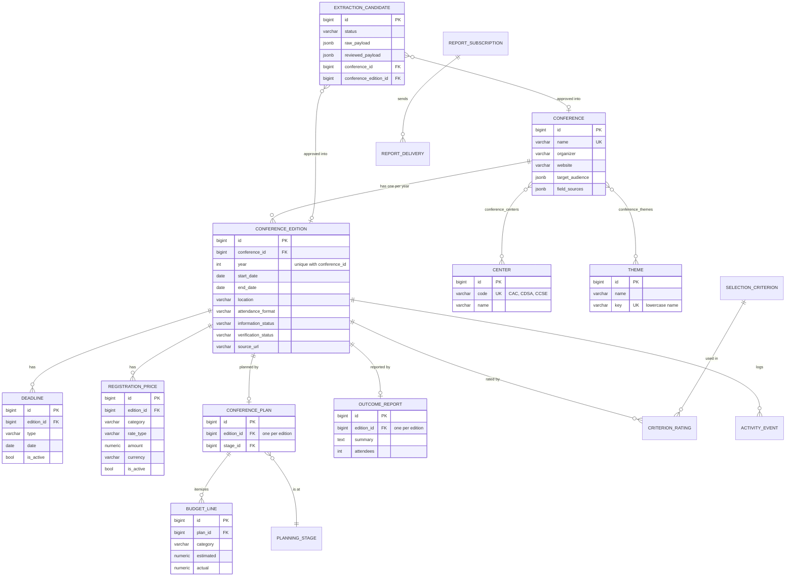

# Database guide

Schema, data dictionary, migrations, backup/restore, and PostgreSQL validation for the
CCSE Conference Intelligence and Planning Platform. Last updated November 2, 2026.

All tables belong to the Django app `conferences`, so every table name starts with
`conferences_`. The team database is PostgreSQL. The local demo scripts and the desktop app use
SQLite with the same migrations.

## Contents

1. [Schema diagram](#schema-diagram)
2. [How yearly history is kept](#how-yearly-history-is-kept)
3. [Data dictionary](#data-dictionary)
4. [Set up a fresh PostgreSQL database](#set-up-a-fresh-postgresql-database)
5. [Upgrade an existing database](#upgrade-an-existing-database)
6. [Backup and restore](#backup-and-restore)
7. [PostgreSQL validation record](#postgresql-validation-record)

## Schema diagram

GitHub renders this diagram. The `auth_user` table is Django's built-in user table.



## How yearly history is kept

- A **conference** is the event in general, such as "Grace Hopper Celebration". It holds only
  facts that stay the same every year.
- A **conference edition** is one year of that event. `(conference_id, year)` is unique, so each
  year gets its own row and a new year never replaces an earlier one.
- Dates, location, deadlines, registration prices, plans, budgets, ratings and outcome reports all
  point to an **edition**, never to the conference. Changing 2026 can't touch 2025.
- Approving an AI suggestion updates only the edition for the year in that suggestion. When a
  deadline date changes, the old row is kept with `is_active = false` instead of being deleted.

To see this in a running app, load the demo example:

```powershell
python manage.py seed_yearly_history
```

It creates **Southeast Applied Computing Summit**, a fictional event labeled "Demo data (not a real
event)". It has a 2025 edition (Atlanta, $450, outcome: 3 attendees) and a 2026 edition (Charlotte,
$495, outcome: 4 attendees), each with its own deadlines, prices, plan, budget and outcome report.
The command can be run more than once safely. `conferences/test_database.py` checks that approving
a 2027 edition leaves the 2025 records unchanged.

## Data dictionary

Types are the PostgreSQL column types. **PK** means primary key, **FK** foreign key, **UK**
unique. Every table has an `id bigint` primary key unless noted, so it isn't repeated below.

### Conference catalog

#### `conferences_conference`

The conference in general, independent of year.

| Column | Type | Null | Notes |
|---|---|---|---|
| name | varchar(255) | no | UK. Official conference name. Matching ignores capitalization. |
| organizer | varchar(255) | yes | Organizing society or company. |
| website | varchar(200) | yes | Main website. Also used to match AI results to an existing conference. |
| target_audience | jsonb | no | List of audience labels from the source. Default `[]`. |
| field_sources | jsonb | no | Where each value came from: source URL, evidence, reviewer, and whether a reviewer corrected it. Default `{}`. |
| created_at | timestamptz | no | When the row was created. |

#### `conferences_center`

The CCSE centers a conference can be relevant to. Seeded by migration `0006`.

| Column | Type | Null | Notes |
|---|---|---|---|
| code | varchar(8) | no | UK. `CAC`, `CDSA` or `CCSE`. |
| name | varchar(120) | no | Center for Applied Computing, Center for Data Science and Analytics, CCSE-wide. |

#### `conferences_conference_centers`

Join table. A conference can relate to any number of centers.

| Column | Type | Null | Notes |
|---|---|---|---|
| conference_id | bigint | no | FK → `conferences_conference.id`. |
| center_id | bigint | no | FK → `conferences_center.id`. The pair is unique. |

#### `conferences_theme`

Shared list of themes/categories, so the same theme isn't stored in many spellings.

| Column | Type | Null | Notes |
|---|---|---|---|
| name | varchar(120) | no | Display name, with extra spaces removed. |
| key | varchar(120) | no | UK. Lowercase name. "AI" and "ai" are the same theme. |

#### `conferences_conference_themes`

Join table between conferences and themes.

| Column | Type | Null | Notes |
|---|---|---|---|
| conference_id | bigint | no | FK → `conferences_conference.id`. |
| theme_id | bigint | no | FK → `conferences_theme.id`. The pair is unique. |

#### `conferences_conferenceedition`

One year of a conference.

| Column | Type | Null | Notes |
|---|---|---|---|
| conference_id | bigint | no | FK → `conferences_conference.id`. Unique together with `year`. |
| year | integer | no | Edition year. |
| start_date, end_date | date | yes | Event dates. Empty means not published or not known. |
| start_time | time | yes | Opening time, if published. |
| timezone | varchar(64) | yes | Timezone for times on this edition. |
| location | varchar(255) | yes | City/venue as published. |
| attendance_format | varchar(16) | yes | `in_person`, `virtual` or `hybrid`. |
| information_status | varchar(32) | no | `NOT_RESEARCHED` (default), `INFORMATION_NOT_PUBLISHED`, `PARTIAL_INFORMATION`, `COMPLETE`, `NEEDS_VERIFICATION`. |
| verification_status | varchar(32) | no | `NEEDS_REVIEW` (default), `VERIFIED`, `REJECTED`. |
| source_url | varchar(200) | yes | Official page for this edition. |
| field_sources | jsonb | no | Per-field sources, plus `legacy_imports` with the spreadsheet row each value came from. |
| last_verified_at | timestamptz | yes | When a reviewer last approved data for this edition. |
| created_at | timestamptz | no | When the row was created. |

#### `conferences_deadline`

| Column | Type | Null | Notes |
|---|---|---|---|
| edition_id | bigint | no | FK → `conferences_conferenceedition.id`. |
| type | varchar(64) | no | Such as `early_registration`, `registration`, `abstract_submission`. |
| date | date | no | Deadline date. |
| time, timezone | time, varchar(64) | yes | Cutoff time and its timezone, if published. |
| source_url, evidence | varchar(200), text | yes | Where the deadline was found and the quoted text. |
| is_active | boolean | no | `false` when a newer review replaced this deadline. Kept for history. |

#### `conferences_registrationprice`

| Column | Type | Null | Notes |
|---|---|---|---|
| edition_id | bigint | no | FK → `conferences_conferenceedition.id`. |
| category | varchar(128) | no | Such as General, Student, Member. |
| rate_type | varchar(64) | no | Such as early, regular, onsite. |
| amount | numeric(8,2) | no | Price in `currency`. |
| currency | varchar(8) | no | Default `USD`. |
| source_url, evidence | varchar(200), text | yes | Where the price was found. |
| is_active | boolean | no | `false` when replaced by a newer review. |

### AI review

#### `conferences_extractioncandidate`

One AI extraction result waiting for, or after, human review. Nothing here reaches the catalog
until it is approved.

| Column | Type | Null | Notes |
|---|---|---|---|
| schema_version | varchar(16) | no | AI output format version. Default `1.0`. |
| status | varchar(16) | no | `needs_review`, `approved`, `rejected`. |
| requested_url | varchar(200) | no | Page the AI was asked to research. |
| raw_payload | jsonb | no | Untouched AI output. |
| reviewed_payload | jsonb | yes | The values the reviewer approved, kept separately from the AI output. |
| review_notes | text | no | Reviewer notes or rejection reason. |
| conference_id, conference_edition_id | bigint | yes | FKs filled in on approval. Set to null if the conference is deleted. |
| submitted_at, reviewed_at | timestamptz | no / yes | When it arrived and when it was reviewed. |
| reviewed_by | varchar(128) | yes | Reviewer name. |

### Planning, evaluation and outcomes

| Table | Purpose | Key columns |
|---|---|---|
| `conferences_planningstage` | Planning statuses: Identified, Under evaluation, Interested, Tentatively planned, Approved, Not attending, Attended. Created by `setup_platform`. | `code` UK, `name`, `position` |
| `conferences_conferenceplan` | The plan for one edition. | `edition_id` FK UK, `stage_id` FK, `owner_id` FK user, `objective`, `notes` |
| `conferences_budgetline` | Itemized estimated and actual costs. Missing amounts stay null instead of 0. | `plan_id` FK, `category` (registration/travel/lodging/other), `currency`, `estimated`, `actual`, `active` |
| `conferences_outcomereport` | What came out of attending one edition. | `edition_id` FK UK, `summary`, `attendees`, `contacts`, `partnerships`, `follow_up`, `follow_up_date`, `follow_up_completed` |
| `conferences_selectioncriterion` | Evaluation criteria per center, with sponsor-approved weights. | `center` (CAC/CDSA/CCSE), `name` (unique per center), `weight`, `approved`, `active` |
| `conferences_criterionrating` | A 1–5 rating of one edition on one criterion. | `edition_id` FK, `criterion_id` FK (pair unique), `rating`, `rationale` |
| `conferences_activityevent` | Activity feed. | `user_id` FK, `action`, `edition_id` FK, `description`, `created_at` |
| `conferences_reportsubscription` | Who gets the weekly report and on which weekday. | `email` UK, `weekday` (0 = Monday), `enabled` |
| `conferences_reportdelivery` | One row per report sent, so a week is never sent twice. | `subscription_id` FK, `period` (pair unique), `sent_at` |

### Access

| Table | Purpose | Key columns |
|---|---|---|
| `conferences_accessinvitation` | Invitation links for new users. Only a hash of the token is stored. | `email`, `role`, `token_hash` UK, `expires_at`, `used_at`, `revoked_at` |
| `conferences_loginthrottle` | Counts failed logins to slow down guessing. | `key` UK, `failures`, `window_started` |

Users, groups and sessions use Django's built-in `auth_*` and `django_session` tables.

## Set up a fresh PostgreSQL database

These steps match what was validated below. Run them from the `ccse-conference-platform` folder.

1. Create an empty database in pgAdmin (right-click **Databases → Create → Database**, name
   `ccse_conference_platform`) or from a terminal:

   ```powershell
   & "C:\Program Files\PostgreSQL\18\bin\createdb.exe" -U postgres ccse_conference_platform
   ```

   Use your own PostgreSQL `bin` folder if it's installed somewhere else.

2. Copy `ccse_platform/local_settings.example.py` to `ccse_platform/local_settings.py` and set your
   PostgreSQL password. This file is git-ignored.

3. Install the PostgreSQL driver and create the tables:

   ```powershell
   pip install -r ..\requirements-postgres.txt
   python manage.py migrate
   python manage.py setup_platform
   ```

4. Load representative data:

   ```powershell
   python manage.py import_cac_workbook "..\data\NEW CAC CONFERENCE LIST 2026.xlsx"
   python manage.py seed_yearly_history
   ```

5. Check it:

   ```powershell
   python manage.py test conferences
   python manage.py runserver
   ```

## Upgrade an existing database

**Always take a backup first** (see the next section).

```powershell
python manage.py showmigrations conferences
python manage.py migrate
```

### Migrations 0005–0007: centers and themes

Before these migrations, centers were two true/false columns on the conference
(`cac_relevant`, `cdsa_relevant`) and themes were a JSON list (`themes`). They are now proper
relationship tables. The change is split into three migrations because PostgreSQL won't alter a
table in the same transaction that just wrote rows referencing it:

| Migration | What it does |
|---|---|
| `0005_center_theme_tables` | Creates `conferences_center`, `conferences_theme` and the two join tables. Renames the old JSON column to `legacy_themes`. |
| `0006_copy_centers_and_themes` | Seeds CAC, CDSA and CCSE, then copies every conference's flags and themes into the new tables. Themes that differ only in capitalization or spacing become one theme. |
| `0007_remove_center_flags_and_theme_json` | Removes `cac_relevant`, `cdsa_relevant` and `legacy_themes`. |

The API still returns `centers` and `themes` as lists of names, so the React workspace and the
desktop app didn't need changes. `data/demo-catalog.json` was converted to the new format.

To undo this change, restoring the backup is the safest option. These migrations can also run
backwards, and copy the data back into the old columns:

```powershell
python manage.py migrate conferences 0004
```

## Backup and restore

`pg_dump` and `pg_restore` are in PostgreSQL's `bin` folder. Replace the path below with yours.
The commands prompt for the `postgres` password.

```powershell
$pg = "C:\Program Files\PostgreSQL\18\bin"
```

### Back up

```powershell
& "$pg\pg_dump.exe" -h localhost -U postgres -Fc -d ccse_conference_platform -f "ccse_backup_$(Get-Date -Format yyyy-MM-dd).dump"
```

`-Fc` writes PostgreSQL's compressed custom format, which `pg_restore` needs. Store backups
outside the Git repository; they contain real data and user accounts.

### Restore into a new database (safest)

```powershell
& "$pg\createdb.exe" -h localhost -U postgres ccse_restore
& "$pg\pg_restore.exe" -h localhost -U postgres --no-owner -d ccse_restore "ccse_backup_2026-11-02.dump"
```

Point the app at it by setting `'NAME': 'ccse_restore'` in `local_settings.py`, then check:

```powershell
python manage.py migrate --check
python manage.py runserver
```

### Restore over the existing database

This replaces everything in the database with the backup's contents.

```powershell
& "$pg\pg_restore.exe" -h localhost -U postgres --no-owner --clean --if-exists -d ccse_conference_platform "ccse_backup_2026-11-02.dump"
```

### SQLite (demo and desktop app)

Stop the server or quit the app, then copy the `.sqlite3` file. To restore, stop it again and copy
the file back.

## PostgreSQL validation record

Run on November 2, 2026 against **PostgreSQL 16.15** with Django 5.2.18 (the version in
`requirements-ai.lock.txt`). The full test suite was then repeated on Windows against
**PostgreSQL 18** (197 tests pass). Other team machines can repeat the steps in
[Set up a fresh PostgreSQL database](#set-up-a-fresh-postgresql-database).

| Check | Result |
|---|---|
| Fresh database built with the current `main` code, real CAC workbook imported | 35 rows → 35 conferences, 35 editions |
| Same database upgraded with migrations 0005–0007 | Every conference's centers, themes and editions identical before and after |
| Re-running the CAC import after the upgrade | 0 new rows, 35 already imported |
| `seed_yearly_history` | 2025 and 2026 editions created with separate dates, prices, deadlines and outcomes |
| Dashboard, text search, theme search, CAC filter | Pass |
| Platform API catalog returns `centers` and `themes` lists | Pass |
| Edit a conference's themes in the form | Saved to the join table |
| Approve and reject an AI candidate | Pass |
| CSV export with CAC/CDSA and Themes columns | Pass |
| Roll back to 0004 and forward again | Flags and themes restored, then moved back |
| `pg_dump` backup → `pg_restore` into a new database | Row counts match in all 30 tables; app runs; yearly history intact |
| Accidental delete of all theme links → `pg_restore --clean` | All 33 links back |
| Full test suite | 197 tests pass on PostgreSQL 16, PostgreSQL 18 (Windows) and SQLite |
